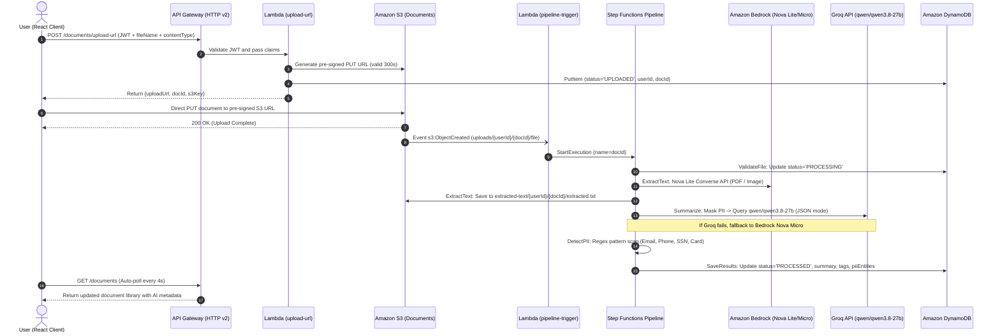
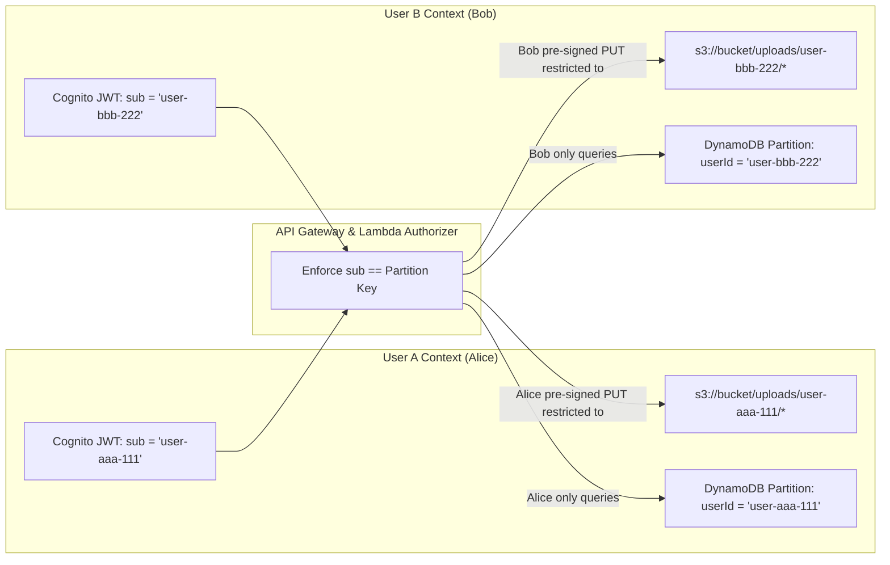
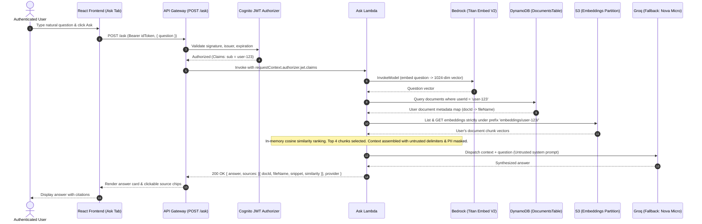
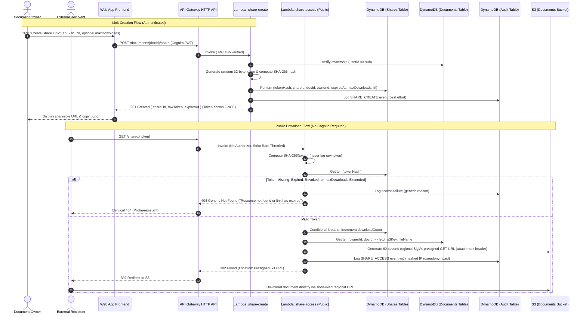
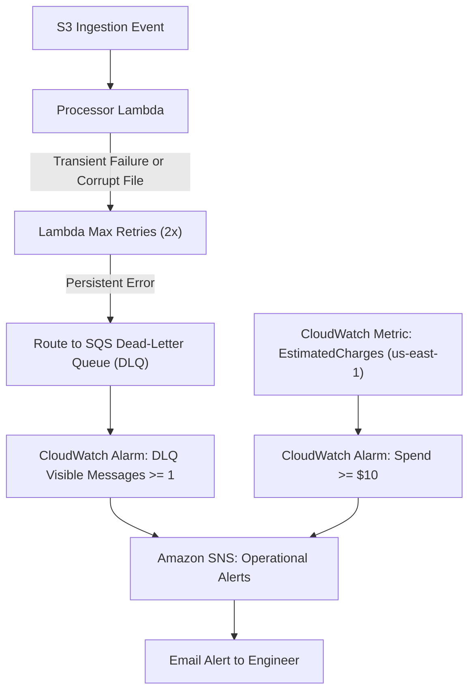

# Smart Document Manager: System Architecture

An enterprise-grade, serverless document management and intelligence platform deployed on AWS in `ap-southeast-2` (Sydney) operating under a \$10/month budget cap.

---

## 1. High-Level Component Architecture

```mermaid
flowchart TD
    User["Web Browser / Client (React SPA)"]
    CF["Amazon CloudFront CDN (HTTPS)"]
    S3Web["S3 Bucket: Static Frontend (OAC Protected)"]
    Cognito["Amazon Cognito User Pool & JWT Auth"]
    APIGW["Amazon API Gateway HTTP API v2"]
    
    subgraph Compute & Logic ["Serverless Compute (Python 3.12 Lambdas)"]
        UploadURL["Lambda: upload-url"]
        ListDocs["Lambda: list-docs"]
        SearchDoc["Lambda: search"]
        DeleteDoc["Lambda: delete-doc"]
        AskDoc["Lambda: ask (Cognito JWT + In-Memory RAG)"]
        AdminStats["Lambda: admin-stats (Server-Enforced Admin Role)"]
    end

    subgraph Storage & Persistence ["Encrypted Storage Tier"]
        S3Docs["S3 Bucket: Private Documents (AES-256)"]
        DDB["Amazon DynamoDB (On-Demand Metadata Table)"]
        DLQ["Amazon SQS Dead-Letter Queue (DLQ)"]
    end

    subgraph Intelligence ["AI & Machine Learning Services"]
        Groq["Groq API (qwen/qwen3.8-27b)"]
        BedrockLite["Amazon Bedrock Nova Lite (Multimodal PDF/OCR)"]
        BedrockMicro["Amazon Bedrock Nova Micro (Summarization Fallback)"]
        BedrockTitan["Amazon Bedrock Titan Embeddings V2 (1024-dim)"]
    end

    subgraph Pipeline ["Step Functions Execution Pipeline"]
        Trigger["Pipeline Trigger Lambda"]
        SFN["AWS Step Functions State Machine"]
        V["1. ValidateFile"]
        E["2. ExtractText"]
        S["3. Summarize (Groq / Nova Micro)"]
        D["4. DetectPII (Regex)"]
        W["5. SaveResults"]
        C["6. ChunkText (~500 tokens)"]
        EM["7. EmbedChunks (Titan Embed V2)"]
        F["Failure Catch: NotifyOnFailure"]
    end

    subgraph Monitoring ["Observability & Guardrails"]
        CWAlarms["CloudWatch Alarms (SFN ExecutionsFailed, DLQ Depth)"]
        CWDashboard["CloudWatch Operational Dashboard"]
        SNSTopic["Amazon SNS Topic Alerts"]
    end

    User -->|1. Request SPA Assets| CF
    CF -->|Fetch Static HTML/JS| S3Web
    User -->|2. Authenticate| Cognito
    User -->|3. API Calls with JWT| APIGW
    APIGW -->|Validate Token| Cognito
    APIGW --> UploadURL
    APIGW --> ListDocs
    APIGW --> SearchDoc
    APIGW --> DeleteDoc
    
    UploadURL -->|Pre-sign PUT| S3Docs
    UploadURL -->|Record Pending Upload| DDB
    User -->|4. Direct S3 Upload| S3Docs
    
    S3Docs -->|5. ObjectCreated Trigger| Trigger
    Trigger -->|StartExecution (name=docId)| SFN
    SFN --> V --> E --> S --> D --> W
    E -->|Multimodal Extraction| BedrockLite
    S -->|Masked PII Prompt| Groq
    S -.->|Fallback| BedrockMicro
    E -->|Write Extracted Text| S3Docs
    W -->|Update Status PROCESSED| DDB

    SFN -. Catch Any Error .-> F
    F -->|Set status FAILED| DDB
    F -->|Publish Error IDs Only| DLQ
    
    DLQ & SFN --> CWAlarms
    CWAlarms --> SNSTopic
    APIGW & SFN & DDB --> CWDashboard
```

---

## 2. Document Ingestion & Asynchronous Processing Sequence



---

## 3. Multi-Tenant Zero-Trust Isolation Architecture



---

## 4. "Ask Your Documents" RAG Sequence & Isolation



---

## 5. Expiring Share Links & Public Resolution Flow (Phase 4)



---

## 6. Fault Tolerance, Dead-Letter Queue & Billing Protection


